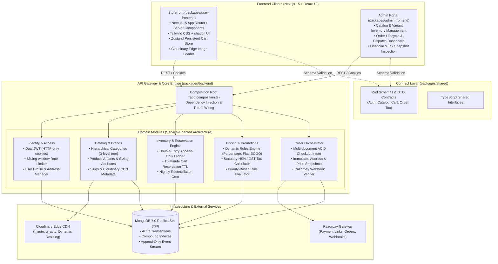
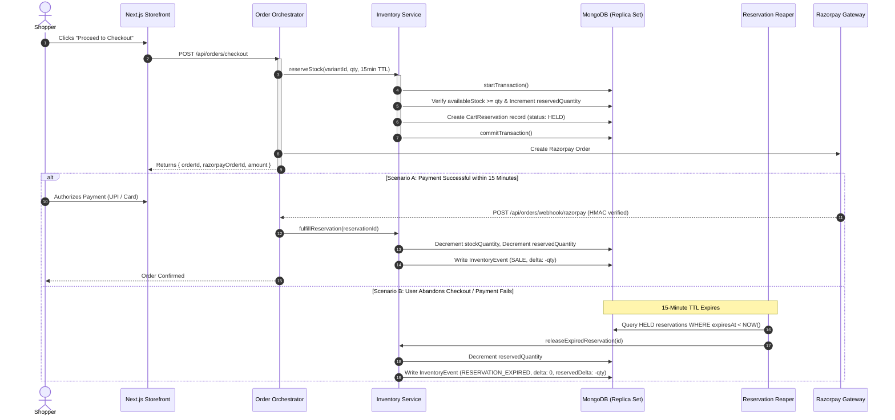

<div align="center">

# VENDOR VOGUE

### High-Concurrency, Legally Compliant Luxury E-Commerce Platform

[-black?style=flat-square&logo=next.js)](https://nextjs.org/)
[](https://react.dev/)
[](https://www.typescriptlang.org/)
[](https://nodejs.org/)
[](https://expressjs.com/)
[-47A248?style=flat-square&logo=mongodb)](https://www.mongodb.com/)
[-F69220?style=flat-square&logo=pnpm)](https://pnpm.io/)
[](https://razorpay.com/)

<p align="center">
  <b>Production-Grade Architectural Monorepo</b> designed for high-concurrency luxury streetwear retail.<br/>
  Features double-entry inventory ledger accounting, multi-document ACID transactions with 15-minute hold TTLs, statutory GST/HSN tax compliance, and a zero-server-CPU Cloudinary edge media pipeline.
</p>

[Storefront](https://vendor-vogue.vercel.app) • [Admin Portal](https://vendor-vogue-admin.vercel.app) • [API Health](https://vendorvogue.onrender.com/health) • [Architecture](#-system-architecture) • [Engineering Highlights](#-core-engineering-highlights) • [Local Development](#-local-development--testing) • [v2 Roadmap](#-v2-roadmap-multi-vendor-marketplace)

</div>

---

## 📌 Executive Summary

**Vendor Vogue** is built from the ground up as a production-grade, enterprise-ready retail engine:

* **v1 Scope (Current)**: A high-performance, **single-vendor luxury apparel e-commerce system** with strict statutory legal compliance (Indian GST/HSN tiered tax codes, immutable invoice snapshots), double-entry stock ledger auditing, race-condition-free cart stock reservations, and an editorial dark/light storefront.
* **v2 Scope (Planned)**: Seamless architectural graduation to a **multi-vendor distributed marketplace**, introducing vendor tenant isolation, automated commission splits via Razorpay Route, multi-vendor cart partitioning, and vendor fulfillment portals.

---

## 🏛 System Architecture

The monorepo follows a clean **Modular Monolith** pattern in the backend with independent dependency injection, paired with Next.js 15 App Router frontends and a shared type/schema contract package.

### Architecture Diagram



---

## 📦 Monorepo Package Breakdown

```text
vendor-vogue/
├── docker-compose.yml              # Local MongoDB 7.0 Replica Set (rs0) container
├── package.json                    # Monorepo root scripts & pnpm workspace config
├── packages/
│   ├── backend/                    # Node.js 20+ Express 5 TypeScript Modular API
│   │   ├── src/
│   │   │   ├── composition/        # Dependency Injection wiring (app.composition.ts)
│   │   │   ├── modules/
│   │   │   │   ├── identity/       # Auth, JWT token rotation, user profile & addresses
│   │   │   │   ├── catalog/        # Products, variants, brands, hierarchical categories
│   │   │   │   ├── inventory/      # Stock reservations, immutable ledger, integrity auditor
│   │   │   │   ├── pricing/        # Dynamic promotions, BOGO, HSN/GST tax calculations
│   │   │   │   ├── cart/           # Server-side cart management
│   │   │   │   ├── order/          # Checkout orchestrator, Razorpay webhooks, reaper worker
│   │   │   │   └── payment/        # Razorpay integration & HMAC cryptographic verifier
│   │   │   └── shared/             # Logging (Pino), database connection, error handlers
│   │   └── tests/                  # Vitest unit & integration test suites
│   ├── user-frontend/              # Next.js 15 (App Router) Editorial Storefront
│   │   ├── src/
│   │   │   ├── app/                # Server & Client Pages (Catalog, PDP, Cart, Account, Checkout)
│   │   │   ├── components/         # Luxury Hero, Gallery, Filters, Drawers, Lightbox
│   │   │   └── lib/                # Zustand stores, Cloudinary loader, API clients
│   ├── admin-frontend/             # Next.js 15 Operations & Fulfillment Portal
│   └── shared/                     # Canonical Zod schemas and TypeScript type definitions
```

---

## ⚡ Core Engineering Highlights

### 1. High-Concurrency Stock Reservation Engine (No Race Conditions)
In flash sales or limited drops (e.g., FW26 Autumn/Winter Campaign), standard `stockQuantity - 1` updates cause severe over-selling due to race conditions.
* **ACID Multi-Document Transactions**: When a customer initiates checkout (`POST /api/orders/checkout`), a MongoDB session starts. The system checks `(stockQuantity - reservedQuantity) >= requestedQuantity` and increments `reservedQuantity` atomically inside the transaction.
* **15-Minute Reservation TTL**: A temporary reservation document is created with an expiry timestamp.
* **Automated Expiry Reaper Worker**: [`ReservationExpiryWorker`](file:///home/aryan/practice/vendor%20vogue/packages/backend/src/modules/order/workers/reservation-expiry.worker.ts) continuously identifies abandoned checkout intents, returns reserved stock to available inventory, and marks reservations as `EXPIRED`.
* **Atomic Payment Fulfillment**: On cryptographic Razorpay webhook verification (`order.paid`), the reservation is atomically marked `FULFILLED`, decrementing physical stock permanently without re-reading stale counts.



---

### 2. Double-Entry Append-Only Inventory Ledger (`InventoryEvent`)
Unlike naive e-commerce databases that overwrite stock figures in-place, Vendor Vogue treats inventory like money in a bank.
* **Immutable Audit Trail**: Every stock movement appends an unmodifiable event record to [`InventoryEvent`](file:///home/aryan/practice/vendor%20vogue/packages/backend/src/modules/inventory/models/inventoryEvent.model.ts) with event types: `RESTOCK`, `SALE`, `RETURN`, `DAMAGED`, `RESERVATION_CREATED`, `RESERVATION_EXPIRED`, `RESERVATION_FULFILLED`, `MANUAL_ADJUSTMENT`.
* **Nightly Automated Integrity Check**: [`runNightlyIntegrityCheck`](file:///home/aryan/practice/vendor%20vogue/packages/backend/src/modules/inventory/services/inventory.service.ts) runs an aggregation pipeline summing all historical deltas from day one:
  $$\sum (\text{InventoryEvent.delta}) \equiv \text{ProductVariant.stockQuantity}$$
  Any discrepancy caused by disk corruption or manual database interference is instantly flagged with the exact order reference and timestamp.

---

### 3. Statutory Legal Compliance & GST/HSN Tax Engine
Built to satisfy commercial tax regulations and legal invoice standards:
* **HSN Code Mapping & Tiered GST**: Products and variants map to standard HSN apparel codes (e.g. `610910`) and dynamic GST slabs (5%, 12%, 18%, 28%).
* **Pre-Tax vs. Post-Tax Discount Distribution**: Statutory tax rules require calculating GST on the *net discounted taxable base*, rather than gross MRP. [`pricing.service.ts`](file:///home/aryan/practice/vendor%20vogue/packages/backend/src/modules/pricing/services/pricing.service.ts) computes intra-state (CGST + SGST) versus inter-state (IGST) breakdowns accurately down to two decimal places.
* **Immutable Snapshot Isolation**: Once an order is placed, customer addresses and product pricing are written into immutable document snapshots (`IShippingAddressSnapshot`, `items.priceSnapshot`). If a vendor changes a product price or the customer edits their profile address tomorrow, historical tax receipts and audit records remain legally frozen.

---

### 4. Dynamic Rules-Based Pricing Engine
Coupons and discounts are decoupled from application code:
* **Rule Criteria**: Configurable via [`pricingRule.model.ts`](file:///home/aryan/practice/vendor%20vogue/packages/backend/src/modules/pricing/models/pricingRule.model.ts) with `PERCENTAGE`, `FLAT_AMOUNT`, and `BOGO` formulas.
* **Granular Scoping**: Rules can target specific categories, specific brands (protecting third-party margins), or specific variant SKUs.
* **Safeguards**: Enforces `minCartValue`, start/end validity dates, and numerical `priority` resolution to prevent coupon stacking exploits.

---

### 5. Zero-Server-CPU Media Edge Architecture
Standard Next.js `sharp` image optimization consumes massive CPU and memory under heavy traffic.
* **Edge-Delegated Transformation**: Custom [`cloudinary-loader.ts`](file:///home/aryan/practice/vendor%20vogue/packages/user-frontend/src/lib/cloudinary-loader.ts) bypasses the Node.js process completely.
* **Automatic Format & Quality Negotiation**: Generates on-the-fly Cloudinary Edge URLs with `f_auto` (serves AVIF on Chrome, WebP on Safari) and `q_auto` (perceptual compression), slashing bandwidth by up to 60%.

---

## 🛠 Tech Stack

| Domain | Technologies |
| :--- | :--- |
| **Storefront & Admin** | Next.js 15 (App Router), React 19, Tailwind CSS, shadcn UI, Lucide Icons |
| **Client State Management** | Zustand (Persistent Cart Store with SSR hydration guards) |
| **Backend Framework** | Node.js 20+, Express 5 (REST API, Modular Service Architecture) |
| **Database & Cache** | MongoDB 7.0 (Replica Set `rs0` for multi-document ACID transactions), Mongoose 8 |
| **Validation & Schema Sharing** | Zod (End-to-end schema compilation across client & server via `@e-com/shared`) |
| **Authentication & Security** | JWT (Dual Access/Refresh token rotation in HTTP-only cookies), Helmet, CORS, Rate Limiters |
| **Payments & Media** | Razorpay Node SDK (Order creation, webhook HMAC validation), Cloudinary CDN Edge |
| **Monorepo Tooling** | pnpm 10 workspaces, Vitest, TypeScript 5.x |

---

## 🚀 Local Development & Testing

Follow these steps to spin up the entire distributed system locally in minutes.

### 1. Prerequisites
* **Node.js**: v20.x or higher
* **pnpm**: v10.x (`npm install -g pnpm`)
* **Docker & Docker Compose**: For local MongoDB replica set

### 2. Clone and Install Dependencies
```bash
git clone https://github.com/your-username/vendor-vogue.git
cd vendor-vogue
pnpm install
```

### 3. Spin Up Local MongoDB Replica Set
Multi-document ACID transactions require MongoDB running as a replica set. The included `docker-compose.yml` configures a self-healing single-node replica set `rs0`:

```bash
docker compose up -d
```
*Verify MongoDB is healthy:*
```bash
docker compose ps
```

### 4. Configure Environment Variables
Copy example configurations in both backend and user-frontend:

```bash
# In packages/backend
cp packages/backend/.env.example packages/backend/.env

# In packages/user-frontend
cp packages/user-frontend/.env.example packages/user-frontend/.env.local
```

Ensure `packages/backend/.env` points to your local replica set:
```ini
PORT=5000
NODE_ENV=development
MONGODB_CONNECTION_STRING=mongodb://localhost:27017/ecomDB?replicaSet=rs0&directConnection=true
ACCESS_TOKEN_SECRET=dev_access_secret_super_secure_jwt_token_12345
REFRESH_TOKEN_SECRET=dev_refresh_secret_super_secure_jwt_token_67890
ACCESS_TOKEN_EXPIRY=15m
REFRESH_TOKEN_EXPIRY=7d
LOGIN_WINDOW_MS=60000
LOGIN_MAX_ATTEMPTS=10
CORS_ORIGIN=http://localhost:3000,http://localhost:3001
RAZORPAY_KEY_ID=rzp_test_placeholder
RAZORPAY_KEY_SECRET=rzp_secret_placeholder
RAZORPAY_WEBHOOK_SECRET=rzp_webhook_secret_placeholder
```

### 5. Seed Database (Categories, Admin, and Initial Catalog)
The repository contains idempotent seeder scripts:

```bash
# Seed 3-tier hierarchical category taxonomy (Men, Women, Kids -> Topwear, Bottomwear -> subcategories)
pnpm seed:categories

# Seed initial admin user credentials
pnpm seed:admin

# Seed sample luxury products with variants and pricing rules
pnpm seed:catalog

# Or seed everything in one command:
pnpm seed:all
```

### 6. Run the Monorepo
Start backend compilation, the REST server, and frontends concurrently:

```bash
# Terminal 1: Watch & compile backend TypeScript
pnpm dev:backend-ts

# Terminal 2: Run backend with Nodemon (port 5000)
pnpm dev:backend-node

# Terminal 3: Run User Storefront (Next.js 15 on port 3000)
pnpm dev:user-front

# Terminal 4: Run Admin Dashboard (Next.js 15 on port 3001)
pnpm dev:admin-front
```

Access the applications:
* **Storefront**: [http://localhost:3000](http://localhost:3000)
* **Admin Dashboard**: [http://localhost:3001](http://localhost:3001)
* **Backend API Health Check**: [http://localhost:5000/health](http://localhost:5000/health)

### 7. Run Test Suites
```bash
# Run backend unit tests (Services, Ledger, Tax calculator)
pnpm test:unit

# Run backend integration tests
pnpm test:integration
```

---

## 🔮 v2 Roadmap: Multi-Vendor Marketplace

Vendor Vogue v1 has been architecturally decoupled so that transitioning to a multi-vendor ecosystem requires zero foundational database restructuring:

* [ ] **Vendor Onboarding & Verification**: Self-service vendor registration, KYC/GSTIN verification, and multi-tenant permission gates.
* [ ] **Razorpay Route (Automated Payouts & Commission Split)**: Real-time split settlement transferring vendor earnings directly to their bank accounts while automatically capturing platform marketplace commissions.
* [ ] **Multi-Vendor Cart Partitioning**: Grouping checkout items by vendor sub-orders with independent shipping SLAs and tracking numbers.
* [ ] **Vendor Portal UI**: Dedicated analytics dashboard for vendors showing low-stock alerts, gross merchandise value (GMV), return rates, and payout statements.
* [ ] **Elasticsearch / Meilisearch Integration**: Typo-tolerant faceted search with synonym expansion for massive catalogs.
* [ ] **Automated PDF Invoice Generation**: Programmatic generation of GST-compliant PDF tax invoices with digital signing upon order completion.

---

## 🌐 Live Deployments & Preview

* **Production Storefront**: [https://vendor-vogue.vercel.app](https://vendor-vogue.vercel.app)
* **Operations Admin Portal**: [https://vendor-vogue-admin.vercel.app](https://vendor-vogue-admin.vercel.app)
* **Backend API Health Check**: [https://vendorvogue.onrender.com/health](https://vendorvogue.onrender.com/health)

---

## 📄 License
This project is licensed under the ISC License.
